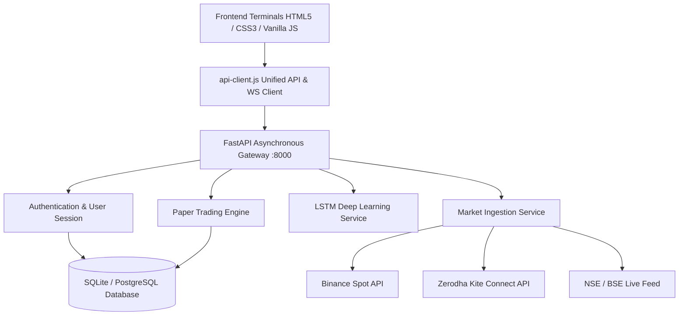

# Investor's EYE 👁️📈

> **Intelligent Market Analysis, Deep Learning Predictions & Mock Trading Platform**  
> An institutional-grade web terminal for Indian Equities, F&O Derivatives, Mutual Funds, and Crypto markets featuring multi-layer LSTM price forecasting, paper trading execution, and real-time exchange integrations (Zerodha Kite Connect & Binance).

---

## 🌟 Key Highlights

- **Live Market Feeds & Exchange Integration:**
  - **Binance API:** Sub-50ms live crypto ticker streams (`BTCUSDT`, `ETHUSDT`, `SOLUSDT`, `BNBUSDT`) and real 30-day OHLCV candlestick data.
  - **Zerodha Kite Connect:** Daily session token generation, OAuth authentication, and live quote ingestion.
  - **NSE/BSE Fallback Engine:** Automatic real-time quote streaming for `NIFTY 50`, `SENSEX`, `BANK NIFTY`, and Indian equities (`RELIANCE`, `TCS`, `INFY`).
- **AI Price Prediction Engine (LSTM Neural Network):**
  - Multi-layer LSTM architecture with Pinball Quantile Loss ($q=0.1, 0.5, 0.9$) forecasting 3, 7, 14, and 30-day price trajectories.
  - Interactive Model Backtest Scorecard with Walk-Forward validation, Sharpe ratio, win/loss ratio, and maximum drawdown metrics.
  - One-click CSV forecast export and direct execution to Mock Trading.
- **Mock / Paper Trading Terminal:**
  - ₹10,00,000 virtual trading cash portfolio.
  - Real-time order execution (`MARKET`, `LIMIT`, `SL`) across Delivery (`CNC`) and 5x Margin Intraday (`MIS`).
  - Realized & unrealized P&L tracking, automated margin calculation, position squaring, and performance equity curves.
- **Comprehensive Analysis Terminal:**
  - Stock fundamentals, PE/PB ratios, RSI, MACD, and moving averages.
  - Options chain analysis with Put-Call Ratio (PCR), Open Interest (OI) buildup, and Greeks.
  - Mutual Fund NAV tracking, alpha, beta, Sharpe ratios, and SIP calculator.
- **Learn & Free Financial Courses:**
  - Curated structured learning tracks (Zerodha Varsity, NSE Academy, YouTube, Coursera).
  - Interactive financial knowledge quizzes and course bookmarking.
- **Secure Authentication & Database Storage:**
  - PBKDF2-HMAC-SHA256 password hashing with 100,000 iterations and per-user cryptographic salts.
  - Persistent SQLite/PostgreSQL storage with SQLAlchemy asynchronous engine (`aiosqlite`).
  - Seamless Day/Night mode theme toggle across all dashboard terminals.

---

## 🏗️ Architecture Overview



---

## 🚀 Quick Start Guide

### 1. Prerequisites
- Python 3.10+
- Git

### 2. Clone & Setup
```bash
git clone https://github.com/TechSnail7/investors-eye.git
cd investors-eye

# Create virtual environment
python -m venv venv
# Windows:
venv\Scripts\activate
# Linux/macOS:
source venv/bin/activate

# Install dependencies
pip install -r backend/requirements.txt
```

### 3. Configure Environment Variables
Copy `.env.example` to `.env`:
```bash
cp .env.example .env
```
*(Optional: add your Zerodha Kite Connect or Binance API keys in `.env` to enable authenticated broker execution)*

### 4. Run Server
```bash
python backend/run.py
```
Visit:
- **Web Terminal:** `http://localhost:8000/`
- **Sign In / Register:** `http://localhost:8000/login.html`
- **LSTM Predictions:** `http://localhost:8000/predictions.html`
- **Mock Trading:** `http://localhost:8000/mock-trading.html`
- **Interactive OpenAPI Docs:** `http://localhost:8000/docs`

---

## 🔒 Security & Privacy
API keys and secrets are strictly excluded from git tracking via `.gitignore`. The project employs PBKDF2 password salting and constant-time verification to prevent timing attacks.

---

## 📄 License
MIT License. Built for educational and analytical purposes.
