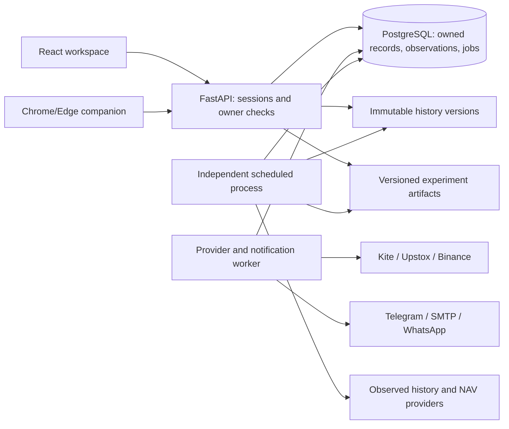

# Application architecture

## Data and persistence

The catalog atomically publishes content-addressed CSV histories. Previous successful instruments remain available after partial provider failure. Replay sessions retain dataset checksums and observation positions within that immutable file. Migrations pin pre-existing sessions before refresh.

PostgreSQL stores users, hashed opaque sessions, generic owned records, provider observations and schema-migration versions. Account mutations serialize through the user's database row lock. SQLite is a test/development fallback. Monetary calculations use Decimal; imported trades use FIFO lots and keep currencies separate.

## Identity and private providers

Passwords use salted PBKDF2-SHA256. Web sessions use HTTP-only cookies; extension sessions use server-stored random-token digests and require explicit pairing. Password reset revokes all sessions. Provider and notification credentials use Fernet authenticated encryption. The production key must be backed up separately.

Only an owner's broker observations authorize their current-market virtual trades. Public observations do not authorize spending the INR wallet in another currency. The UI clears private replay and feature state on sign-out or identity change. Source files, credentials, databases and model binaries are not public static assets.

## Replay and research

Replay uses the session's pinned history and advances to later observed bars. Orders reserve cash/shares; fills, cancellation, optional basis-point fees and gap rejections update the same transactional wallet. Replay is not a production derivative settlement or margin engine.

The forecasting process compares last-price, moving-average, gradient boosting and a three-quantile LSTM across three expanding chronological folds. Scaling is fitted within each training period. Later labels are purged at boundaries. Artifacts include datasets, settings, preprocessing, weights, fold results and actual held-out predictions. A PostgreSQL registry retains runs and predictions; later source observations fill outcomes. Experimental visibility is distinct from qualification.

The scheduler runs independently of web requests after market-close refresh time, with persistent job status, attempts and retry information. Provider/job failures retain the last valid artifacts rather than replacing them with generated values. A successful daily refresh also creates an encrypted backup. Restore verification compares against the same exported PostgreSQL snapshot used by the dump, so live writes cannot invalidate its reference counts.

## Imports and delivery

CSV imports have preview, mapping, strict numeric/date checks and duplicate-safe commit. Real broker imports never mutate the virtual wallet. Reconciliation flags missing opening history and unsupported corporate actions.

Alert firings create durable outbox records. Recipient verification is required for external delivery. Provider acceptance is `sent`; signed provider receipts can set `confirmed`. A lost response after possible acceptance becomes `uncertain`, requiring explicit retry. Connection failures before acceptance have bounded retries. Quiet hours delay delivery without changing the triggering observation.

## Delivery package

Compose separates PostgreSQL, web, provider/notification worker and training scheduler. Shared named volumes retain histories, model artifacts and runtime keys. The production override adds HTTPS and a private-team IP allowlist. The final serving image excludes the training framework; training is a separate image stage/process. Container execution and cloud release remain acceptance gates, not claims inferred from valid configuration.
